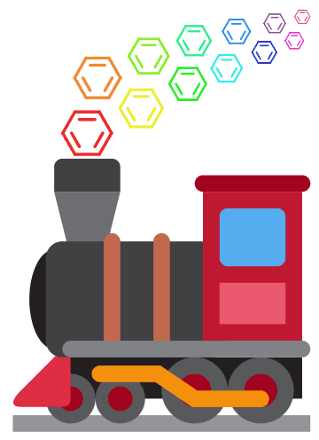

  <a href="https://chemtrain.github.io/"><picture>
    <source media="(prefers-color-scheme: dark)" srcset="https://raw.githubusercontent.com/ChemTrain/.github/main/profile/chemtrain-loader-dark.gif">
    
  </picture></a>

<h2 align="center">Learn chemistry, one card at a time.</h2>

  <a href="https://chemtrain.github.io/"><b>Open ChemTrain →</b></a>
    
  <a href="https://www.schoenebeck.oc.rwth-aachen.de">Schoenebeck Group</a> · RWTH Aachen

